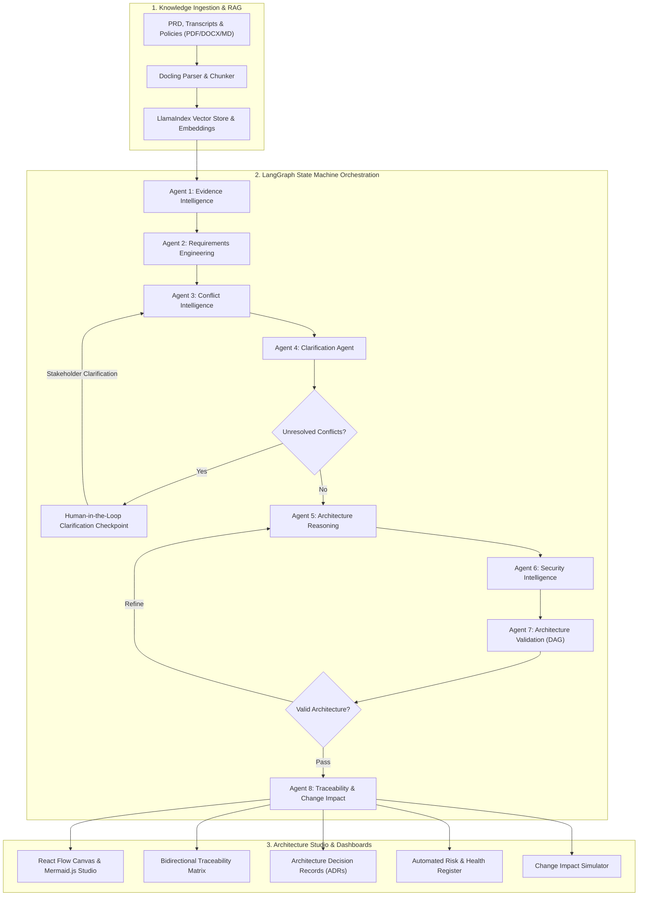

# ArchMind AI – Evidence-Driven Agentic Software Architect
### TCS AI Hackathon – Challenge 02: Requirements-to-Architecture Agent

[](https://github.com)
[](https://github.com)
[](https://ai.google.dev)
[](https://fastapi.tiangolo.com)
[](https://nextjs.org)

ArchMind AI transforms fragmented, incomplete, and contradictory software requirements into explainable, validated, and traceable enterprise software architecture. It operates as a team of 8 specialized engineering agents orchestrated by a central LangGraph stateful machine.

---

## 🏛️ System Architecture & Agent Pipeline



---

## 🤖 The 8 Specialized Engineering Agents

| Agent | Module | Key Responsibilities |
|---|---|---|
| **Agent 1: Evidence Intelligence** | `evidence_agent.py` | Docling document parsing, quote attribution, citation provenance, quality grading, deduplication. |
| **Agent 2: Requirements Engineering** | `requirements_agent.py` | IEEE normalization, FR/NFR/Constraint classification, ambiguity detection, provenance tracking. *Enforces: Never silently convert an assumption into a confirmed requirement.* |
| **Agent 3: Conflict Intelligence** | `conflict_agent.py` | Direct contradictions, deployment topology clashes, SLA collisions, stakeholder priority tensions. |
| **Agent 4: Clarification Agent** | `clarification_agent.py` | Generates architectural trade-off options, manages LangGraph stateful pauses for human-in-the-loop decisions. |
| **Agent 5: Architecture Reasoning** | `architecture_agent.py` | Evaluates Monolith vs Microservices vs Sovereign Hybrid. Justifies trade-offs. Generates components, APIs, data flows, and formal ADRs. |
| **Agent 6: Security Intelligence** | `security_agent.py` | Threat modeling, mTLS, PCI-DSS 4.0 compliance, HSM cryptographic signing, zero-PII edge caching. |
| **Agent 7: Architecture Validation** | `validation_agent.py` | NetworkX deterministic cycle detection (acyclic DAG), coverage verification, transparent risk register scoring. |
| **Agent 8: Traceability & Impact** | `traceability_agent.py` | Evidence → REQ → Component → API → ADR → Validation matrix. What-if change impact simulation with diff generation. |

---

## 🎯 Reference Demonstration Project: SmartBank 2.0

ArchMind AI ships with a complete reference enterprise project: **SmartBank 2.0 - Next-Generation Digital Banking Platform**.

### Contradictions Resolved Autonomously by ArchMind AI:
1. **SMS OTP vs Passwordless FIDO2 vs PCI-DSS 4.0 MFA:**
   - *Conflict:* Mobile Lead demands SMS OTP for tier-2 onboarding; CX Head mandates FIDO2 passwordless; CISO & PCI-DSS 4.0 strictly prohibit SMS OTP for transfers > $250.
   - *Resolution:* **ADR-002: Adaptive Step-Up Authentication** — SMS OTP permitted for low-risk onboarding; biometric/FIDO2 mandatory for monetary transfers.
2. **On-Premises Tier-IV Datacenter vs AWS Cloud Multi-Region:**
   - *Conflict:* Infrastructure policy mandates on-prem private datacenter for core ledger; Cloud Architect proposes AWS serverless; Central Bank directives forbid cross-border customer PII replication.
   - *Resolution:* **ADR-001: Sovereign Hybrid Architecture** — Stateless edge API gateways and Redis caching in domestic AWS Local Zones; Core Ledger and HSM key enclaves isolated in Tier-IV On-Premises enclave.
3. **Sub-2.0s Login P99 SLA vs 100,000 Concurrent User Surge:**
   - *Conflict:* Hybrid network hops to legacy database exceed 1.5s during morning login storms of 8,500 TPS.
   - *Resolution:* **ADR-003: Distributed In-Memory Session Caching** — Edge Redis Cluster intercepts JWT validation in < 2ms, decoupling reads from core database.

---

## 🚀 Quickstart & Execution Guide

### Option 1: Direct Local Execution (Recommended for Fast Evaluation)

#### 1. Backend Setup
```bash
# Navigate to backend
cd archmind-ai/backend

# Create virtual environment (optional)
python -m venv venv
venv\Scripts\activate  # On Windows
source venv/bin/activate  # On Linux/macOS

# Install dependencies
pip install -r requirements.txt

# Configure environment (optional Gemini API key for live LLM mode)
cp .env.example .env

# Run FastAPI backend
python -m uvicorn app.main:app --host 0.0.0.0 --port 8000 --reload
```
*Backend API and interactive Swagger docs will be live at `http://localhost:8000/docs`.*

#### 2. Frontend Setup
```bash
# Navigate to frontend
cd archmind-ai/frontend

# Install dependencies
npm install

# Run Next.js in development mode
npm run dev
# OR build and run in production mode
npm run build
npm run start
```
*Frontend workspace will be live at `http://localhost:3000`.*

---

### Option 2: Docker Compose

```bash
cd archmind-ai
docker compose up --build
```
This launches:
- **PostgreSQL 16 with pgvector:** `localhost:5432`
- **FastAPI Agent Backend:** `localhost:8000`
- **Next.js Enterprise Frontend:** `localhost:3000`

---

## 📊 Application Views

1. **Input Studio (`/input`):** Dedicated multi-modal ingestion hub offering two input pathways:
   - **Upload Document:** Direct drag-and-drop or file selection for PDF, DOC, DOCX, TXT, and Markdown files.
   - **Write / Paste Text:** Interactive rich text editor with 3 pre-configured enterprise architectural domain templates (*Healthcare Telehealth & EHR Platform*, *Autonomous Fleet Telematics & IoT Mesh*, and *Global High-Volume E-Commerce Platform*).
   - Execution options for immediate end-to-end architecture generation or human-in-the-loop clarification pausing, with live real-time agent execution pipeline tracking.
2. **Overview Dashboard (`/dashboard`):** Real-time analytics, requirement category distributions, conflict severity charts, architecture health radar, and LangGraph state machine status.
3. **Evidence Workspace (`/evidence`):** Ingested documents (PDF, DOCX, TXT, MD), verbatim quote explorer, provenance viewer, and quality grades.
4. **Requirements Intelligence (`/requirements`):** Normalized IEEE specifications, classification filters, fact/assumption status, and inline requirement editor.
5. **Conflict Detective (`/conflicts`):** Direct contradictions, architectural tension explanations, technical impacts, and resolution actions.
6. **Clarification Room (`/clarification`):** Human-in-the-loop checkpoint. Stakeholder options and custom directives that automatically resume downstream architecture generation.
7. **Architecture Studio & Governance Gate (`/architecture`):**
   - **Architecture Transition Review & Confirmation Gate:** Executive sign-off workflow allowing lead architects to formally confirm target architectures, swap technology layers, or request refinements. Confirmation automatically marks all Architecture Decision Records (ADRs) as Accepted.
   - **Architecture Evolution: Old vs New:** Side-by-side comparative analysis of the Legacy Monolith Baseline vs Target Prescribed Mesh, including flaw breakdowns, innovation profiles, and dual Mermaid diagrams.
   - **Performance Delta Matrix:** Dimension-by-dimension comparison table across latency (P99), throughput (TPS), availability SLA, disaster recovery (RPO/RTO), and cryptographic security.
   - **Tech Stack Recommendations & Trade-Offs:** Concrete technical justification for every recommended framework, database, cache, broker, and HSM, accompanied by rejected alternatives with pros, cons, and "Why Rejected" rationale.
   - **Diagram Canvas & Interactive Graph:** React Flow canvas, 5 Mermaid.js diagrams (High-Level, Component, Deployment, Data-Flow, Sequence), service catalog, and API endpoints.
8. **ADR Management (`/decisions`):** Architecture Decision Records with context, problems, decisions, alternatives, trade-offs, and human acceptance controls.
9. **Traceability Matrix (`/traceability`):** End-to-end provenance matrix with unadulterated mathematical coverage scoring.
10. **Risk & Validation Engine (`/validation`):** NetworkX DAG cycle detection, deterministic structural tests, and transparent risk scoring.
11. **Change Impact Simulator (`/impact-analysis`):** Interactive requirement modification simulator predicting affected components, APIs, ADRs, database implications, and scaling risks.
12. **Dossier Report Export:** Instant export of comprehensive Markdown architecture dossiers.

---

## 🛠️ Technology Stack

- **Frontend:** Next.js 14, TypeScript, Tailwind CSS, React Flow, Mermaid.js, Recharts, Framer Motion, Lucide React.
- **AI & Orchestration:** Python 3.11+, LangGraph StateGraph, Google Gemini API (`gemini-2.0-flash`), Pydantic v2.
- **RAG & Knowledge Retrieval:** Docling document converter, LlamaIndex, semantic chunking, cosine similarity vector retriever.
- **Backend & Database:** FastAPI, SQLAlchemy 2.0, PostgreSQL with `pgvector`, SQLite dual-engine compatibility.
- **Graph Verification:** NetworkX directed graph cycle analysis.

---

*ArchMind AI – Engineered for TCS AI Hackathon Challenge 02.*

# Archmind-AI

# Archmind-AI

